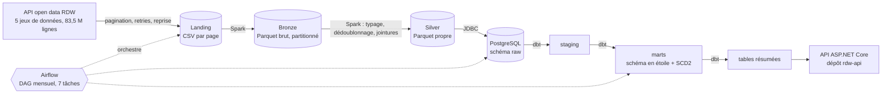
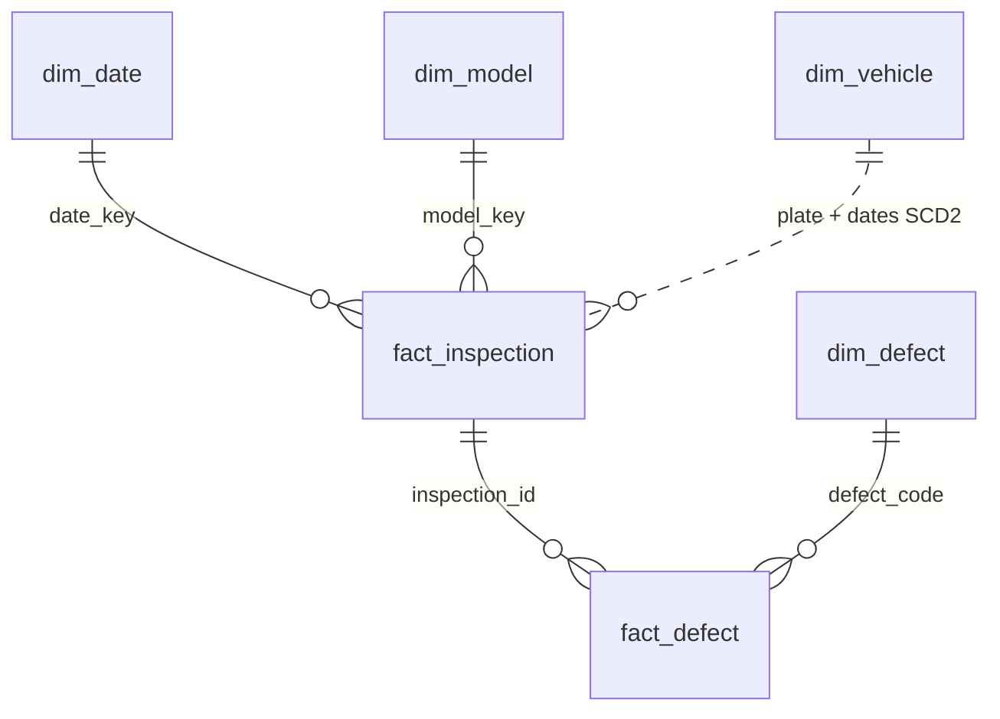

# Fiabilité des véhicules aux Pays-Bas : pipeline Data Engineering

[](https://github.com/malki1997-dev/rdw-car-reliability-pipeline/actions/workflows/ci.yml)

Pipeline de bout en bout sur les données ouvertes du RDW (l'autorité néerlandaise des véhicules) : 83,5 millions de lignes ingérées depuis l'API, nettoyées avec Spark, modélisées en étoile avec dbt dans PostgreSQL et orchestrées par Airflow. Les résultats sont exposés par une API ASP.NET Core dans un [dépôt séparé](https://github.com/malki1997-dev/rdw-api).

**Question métier :** quelles marques et quels modèles ont le plus de défauts au contrôle technique (APK), et comment cela évolue-t-il avec l'âge du véhicule ?

## Architecture



## Chiffres clés

| Mesure | Valeur |
| --- | --- |
| Données ingérées | 83,5 M lignes, 5 jeux de données |
| CSV vers Parquet | 5,9 Go vers 705 Mo ; requête de 13,1 s à 1,9 s |
| Parquet vers PostgreSQL | 870 Mo vers 8,1 Go (stockage par colonne contre par ligne) |
| Pipeline complet (téléchargement déjà fait) | 7 tâches Airflow, 36 minutes |
| Couche Gold | 24,6 M contrôles APK, 24,6 M défauts |
| Tables résumées pour l'API | 3 887 et 16 130 lignes (520 Ko et 1,4 Mo) |
| Tests | 5 pytest, 15 tests dbt génériques, 2 tests dbt métier |

## Modèle de données



- `fact_inspection` : une ligne par contrôle APK.
- `fact_defect` : une ligne par type de défaut dans un contrôle.
- `dim_vehicle` : historisée en SCD2 (`valid_from`, `valid_to`, `is_current`) grâce à un snapshot dbt.

## Décisions techniques

- **Ingestion robuste :** pagination de l'API, retries, reprise sur les pages déjà téléchargées, marqueur `_SUCCESS`. Un seul gros fichier avait échoué sur une coupure réseau.
- **Architecture médaillon :** Bronze n'est jamais modifié (source de vérité), Silver est propre mais complet, Gold applique les règles métier (APK uniquement).
- **Idempotence :** la date d'ingestion est un paramètre ; relancer un mois reproduit les mêmes données sans doublons.
- **Pré-agrégation :** l'API lit deux tables de 3 887 et 16 130 lignes au lieu de 24,6 M. Le calcul est refait à chaque exécution du pipeline, donc les données ne sont pas en temps réel.
- **Moindre privilège :** l'API utilise un compte PostgreSQL en lecture seule sur deux tables ; dbt réapplique les droits à chaque exécution.
- **Secrets :** jamais dans le dépôt (`.env` est ignoré par Git, un modèle est fourni dans `.env.example`).

## Problèmes rencontrés

| Problème | Cause | Solution |
| --- | --- | --- |
| 56 183 véhicules en double | Pagination par offset pendant une mise à jour de la source (pages 279 et 280) | Bronze conservé, dédoublonnage en Silver ; correctif prévu : keyset pagination |
| Run Airflow « Success » sans aucune tâche | Date logique antérieure au `start_date` | `start_date` corrigé, `max_active_runs=1` |
| Téléchargement de plusieurs heures relancé par erreur | Le script ignorait `INGESTION_DATE` | Variable lue par le script ; détecté grâce à une durée anormale |
| WSL planté pendant le chargement PostgreSQL | Mémoire saturée (repartition et 4 Go de driver sur 7,7 Go) | Mémoire WSL augmentée, `coalesce`, chargement table par table |
| 657 069 dates d'expiration valant « 0 » | Valeur sentinelle de la source | Convertie en NULL et documentée |

## Lancer le projet

Prérequis : Docker, Java 17, Python 3.14.

```bash
python -m venv .venv && source .venv/bin/activate
pip install -r requirements.txt
cp .env.example .env            # puis remplacer les mots de passe
set -a; source .env; set +a
docker compose up -d postgres
```

**Étape par étape :**

```bash
export INGESTION_DATE=2026-10-08
python scripts/download_rdw.py                      # plusieurs heures la première fois
spark-submit --master "local[4]" --driver-memory 3g spark/bronze_ingest.py
spark-submit --master "local[*]" --driver-memory 4g spark/pipeline_silver.py
spark-submit --master "local[4]" --driver-memory 3g \
    --packages org.postgresql:postgresql:42.7.4 spark/load_postgres.py
cd dbt && dbt snapshot && dbt run && dbt test
```

**Avec Airflow :**

```bash
docker build -t rdw-airflow:3.3.1 airflow/
docker compose up -d
```

Ouvrir http://localhost:8080 et lancer le DAG `rdw_pipeline` avec le paramètre `ingestion_date`. L'authentification est désactivée : usage local uniquement.

## Tests et intégration continue

- **pytest :** transformations Spark testées sur de petits DataFrames (valeur sentinelle, nettoyage du modèle, dédoublonnage, règles de carburant, absence de multiplication dans les jointures).
- **dbt :** unicité, non-nullité, intégrité référentielle, valeurs acceptées, et règles métier en SQL.
- **GitHub Actions :** à chaque push, `ruff`, `pytest` et `dbt parse`. Les tests dbt sur les 24 M de lignes tournent dans Airflow, pas dans la CI.

## Limites

- **Taux de défaut n'est pas fiabilité.** Les défauts les plus fréquents sont des pneus et des éclairages, donc de l'entretien. Le kilométrage n'est pas disponible.
- **Biais d'âge.** Une Toyota Yaris essence affiche 52,8 % de contrôles avec défaut contre 38,7 % pour l'hybride, mais l'âge moyen est de 16,8 contre 9,2 ans. À 8 à 10 ans, les taux sont quasi identiques (39 à 41 %) ; à 3 à 5 ans, l'hybride est meilleure.
- Un même nom de modèle peut regrouper plusieurs générations.
- Le SCD2 est démontré par un changement simulé sur 3 véhicules. La stratégie `check` est lente (345 s pour 16,8 M lignes) car la source n'a pas de date de mise à jour fiable.
- Le pipeline tourne en local. L'API n'est pas encore déployée en ligne.

## Structure du dépôt

```text
airflow/    image Docker Airflow et DAGs
dbt/        projet dbt : staging, marts, snapshot, tests
docs/       sources.md : documentation des données et constats de qualité
scripts/    téléchargement RDW, vérification des clés
spark/      bronze_ingest, pipeline_silver, load_postgres, module rdw/
tests/      tests pytest
```
